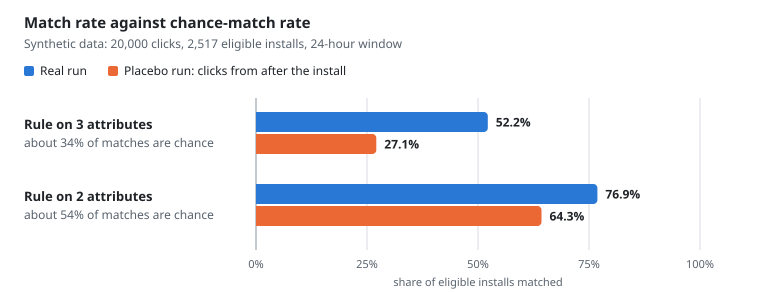
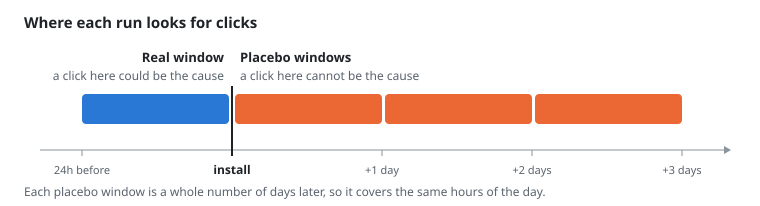

<h1 align="center">chancematch</h1>

<p align="center">
  <b>How many of the matches your attribution rule finds would it also find by chance?</b><br>
  A placebo test for click-to-install matching, in one small command-line tool.
</p>

<p align="center">
  
  
  
</p>

<p align="center">
  <picture>
    <source media="(prefers-color-scheme: dark)" srcset="docs/results-dark.svg">
    
  </picture>
</p>

A match rate tells you how often a rule links an install to a click. It does not tell you how often that link is real.

`chancematch` runs your rule twice. Once on the real data. Once against clicks that happened **after** each install. A click that comes after an install cannot have caused it, so every match in the second run is a match that cannot be causal. That second number is the rule's **chance-match rate**.

In the chart above, the rule with the higher match rate is the worse rule. The match rate alone could not have told you that.

- **Small.** One Python package, no dependencies.
- **Private.** No network calls. Your files stay on your machine.
- **Checkable.** It ships with a synthetic data generator that records the true cause of every install, so you can test the method before you trust it.

It is not an attribution system and it collects nothing. It scores a rule on two logs you already hold.

## Quick start

```bash
git clone https://github.com/lohani-mohit/chancematch
cd chancematch
pip install .

# 1. Make synthetic clicks and installs, with the truth recorded
chancematch simulate --out demo

# 2. Test a rule on them
chancematch run --clicks demo/clicks.csv --installs demo/installs.csv \
  --keys attr_a,attr_b,attr_c --truth demo/truth.csv
```

No install needed if you prefer: `PYTHONPATH=src python3 -m chancematch ...`

```
Rule: same attr_a, attr_b, attr_c; click within 1d before the install; latest click wins
Clicks: 20,000   Installs: 4,015   Eligible installs: 2,517

                            matched    rate   95% interval
Real run                      1,314   52.2%   50.3 to 54.2%
Placebo, +1d                    675   26.8%
Placebo, +2d                    698   27.7%
Placebo, +3d                    679   27.0%
Placebo, +7d                    673   26.7%
Chance-match rate (mean)              27.1%   25.8 to 28.3%

Estimated installs with a real link:    34.5%   31.9 to 37.0%
Estimated matches that are chance:      34.0%   31.1 to 36.9%
Real run over placebo:                  1.93x

Ground truth (eligible installs)
Installs with a real link:              35.4%
Matches that are chance only:           32.2%
Matches given to the wrong click:       34.9%   (35 had a real link but a later click won)
```

Now drop one attribute from the rule:

```bash
chancematch run --clicks demo/clicks.csv --installs demo/installs.csv \
  --keys attr_a,attr_b --truth demo/truth.csv
```

| Rule | Match rate | Chance-match rate | Matches that are chance (estimate) | Ground truth |
|---|---|---|---|---|
| 3 attributes | 52.2% | 27.1% | 34.0% | 32.2% |
| 2 attributes | 76.9% | 64.3% | 54.1% | 54.0% |

> [!NOTE]
> These numbers come from made-up data. They follow from the generator's settings and say nothing about any real system. They are here to show how to read the report.

## How it works

<p align="center">
  <picture>
    <source media="(prefers-color-scheme: dark)" srcset="docs/timeline-dark.svg">
    
  </picture>
</p>

The idea comes from epidemiology, where it is called a **negative control**: measure the "effect" of an exposure that cannot cause the outcome but shares the same biases as the real one. Whatever effect shows up is bias.

Here the exposure is an ad click and the outcome is an install. The negative control is a click from the future.

Three choices make the placebo a fair comparison:

- **It looks forward.** A click from two days *before* an install might be its real cause, just outside your window. A click from after the install cannot be.
- **It moves in whole days.** Click volume changes through the day. A shift of exactly one day compares each install with the same hours of another day. Seven days keeps the day of the week too.
- **It uses several offsets.** If the placebo rates disagree a lot with each other, click volume is drifting and one number will not describe the chance rate well.

Reference: Lipsitch, Tchetgen Tchetgen and Cohen, *Negative Controls: A Tool for Detecting Confounding and Bias in Observational Studies*, Epidemiology 21(3), 2010. [Free full text](https://pmc.ncbi.nlm.nih.gov/articles/PMC3053408/).

## Reading the report

| Line | Meaning |
|---|---|
| **Real run** | Installs with at least one click that has the same key values, inside the window before the install. |
| **Placebo, +1d** | The same rule on clicks from one day later. None of these matches can be causal. |
| **Chance-match rate** | The mean of the placebo rates. |
| **Estimated installs with a real link** | `(real - placebo) / (1 - placebo)`. The share of installs the rule links for a reason other than chance. |
| **Estimated matches that are chance** | The share of the real run's matches that would exist with no real link at all. |
| **Real run over placebo** | How far the real run clears the placebo. Close to 1 means the rule is mostly matching by chance. |
| **Ground truth** | Shown only with `--truth`, which only simulated data has. |

## Use it on your own data

```bash
chancematch run --clicks clicks.csv --installs installs.csv --keys colA,colB --window 24h
```

| | |
|---|---|
| **Files** | Two CSV files with a header row. Clicks need a time column (`click_time`) and the key columns. Installs need a time column (`install_time`) and the same key columns. Other names: `--click-time-col`, `--install-time-col`. |
| **Times** | ISO 8601 (`2026-01-05T14:03:00Z`), or epoch seconds or milliseconds. A time with no zone is read as UTC. |
| **Rule** | An install matches when a click has equal values in every `--keys` column and falls inside `--window` before the install. The latest such click wins. Rows with an empty key value never match. |
| **Placebo** | `--offsets 1d,2d,3d,7d` by default. Each offset must be at least as long as the window. |
| **Output** | A text report, or `--json` for scripts. |

The click log has to cover the window before each install and the longest offset after it. Installs too close to either end of the log are left out of both runs. The report says how many remain as "eligible installs".

"Clicks" and "installs" are only names. Any pair of event logs joined by shared attributes and a time window fits: emails and purchases, scans and visits.

## What the estimate assumes, and where it stops

- **A chance match is equally likely for installs with and without a real link.** The formula `real = link + (1 - link) × placebo` depends on it. If linked installs happen at busier hours than the rest, the estimate shifts.
- **It is a floor on wrong matches, not the total.** An install can have a real click and still be given to a later, unrelated one. The placebo cannot see that. In the demo, 32.2% of matches were chance only, and 34.9% went to the wrong click.
- **The same person can click again after installing.** Those clicks match in the placebo. They cannot be causal, so they belong there, but they are not random collisions either.
- **Real links outside the window count as no link.** The tool judges the rule you gave it.
- **The intervals are approximate** (Wilson for the real run, delta method for the rest). Across 20 simulated datasets, the truth fell inside the 95% interval 37 times out of 40 for the link rate and 35 out of 40 for the chance share.

## Tests

```bash
PYTHONPATH=src python3 -m unittest discover -s tests
```

## Licence

MIT. See [LICENSE](LICENSE).
